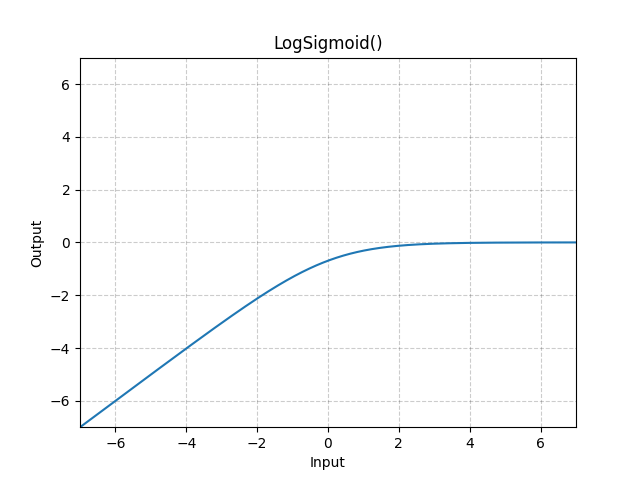

# LogSigmoid

*class*torch.nn.LogSigmoid(**args*, ***kwargs*)[[source]](https://github.com/pytorch/pytorch/blob/b5cf35aa75e0d5087ede9131ab2f970aa2de6509/torch/nn/modules/activation.py#L933)

Applies the Logsigmoid function element-wise.

LogSigmoid(x)=log⁡(11+exp⁡(−x))\text{LogSigmoid}(x) = \log\left(\frac{ 1 }{ 1 + \exp(-x)}\right)

LogSigmoid(x)=log(1+exp(−x)1​)
Shape:

- Input: (∗)(*)(∗), where ∗*∗ means any number of dimensions.
- Output: (∗)(*)(∗), same shape as the input.



Examples:

```
>>> m = nn.LogSigmoid()
>>> input = torch.randn(2)
>>> output = m(input)
```

forward(*input*)[[source]](https://github.com/pytorch/pytorch/blob/b5cf35aa75e0d5087ede9131ab2f970aa2de6509/torch/nn/modules/activation.py#L952)

Run forward pass.

Return type:

[*Tensor*](../tensors.html#torch.Tensor)